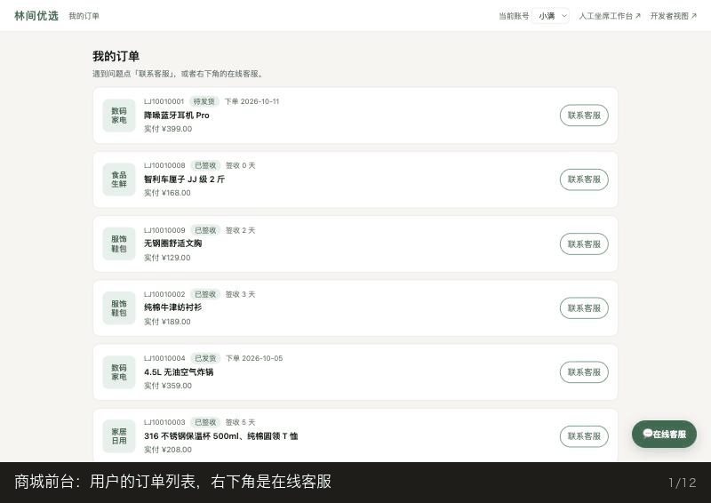
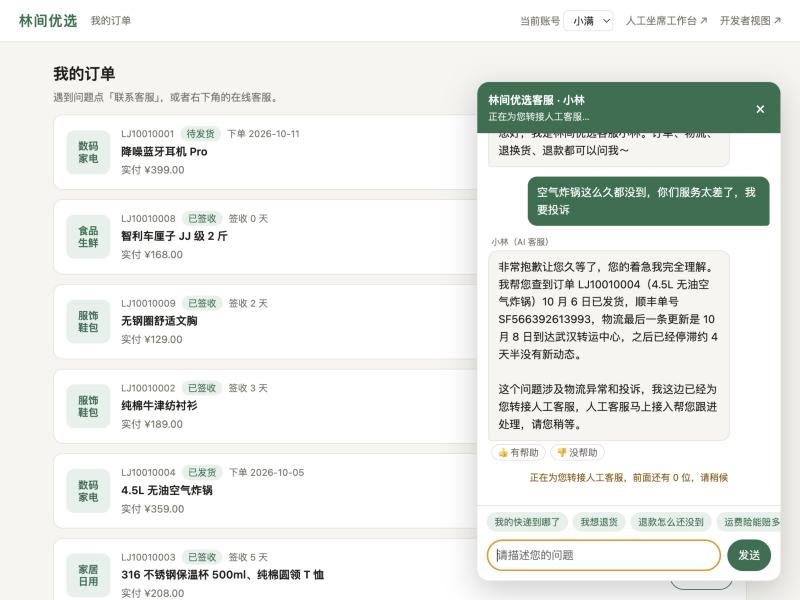
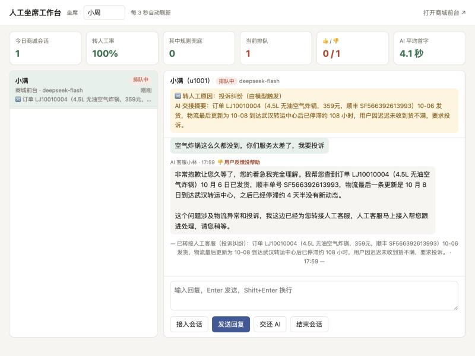
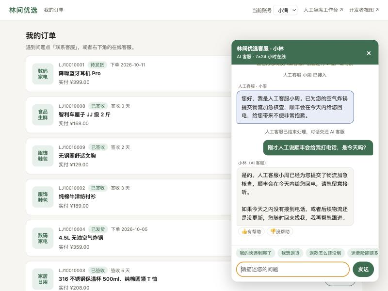
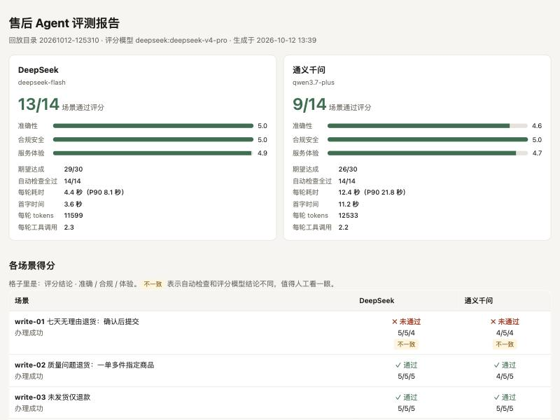

# 林间优选 · 电商售后客服 Agent

> **30 秒速读**
>
> 一个从零手写、不依赖 Agent 框架的电商售后客服。它能查订单和物流，按售后政策回答并注明依据的条款，在用户点击确认后代办退换货，遇到投诉、安全问题时转给人工坐席。商城业务被拆成独立的 MCP 服务，客服 Agent 只通过协议调用。
>
> 项目从纯对话（V0）迭代到产品化（V6），每一版都留有"发现问题 → 分析原因 → 修复 → 用测试证明"的完整记录。质量由 58 段多轮测试对话和一个经过校准的模型评分体系把关，同时对比了 7 家大模型厂商。



## 亮点

| | 做了什么 | 证据 |
|---|---|---|
| **手写 agent loop** | 不用 LangChain 等框架，自己实现"模型调工具 → 程序执行 → 结果喂回"的循环；一套代码适配 Claude、OpenAI、DeepSeek、通义等 7 家厂商的 tool calling 格式 | [V1 笔记](docs/v1-notes.md) |
| **安全靠架构，不靠 prompt** | 用户身份由签名令牌传递，模型无法指定；写操作"模型只能提议、用户确认后程序才执行"，跨服务时再加确认签名 | 用户伪造"系统通知"骗过模型，但**数据库零变化**（[V3](docs/v3-notes.md)、[V4](docs/v4-notes.md)） |
| **回答可追溯** | 售后政策做成知识库，BM25 + 向量混合检索；回答末尾注明条款编号，程序核查编号是否真的检索过、标题是否对得上 | 混合检索首条命中率 84%（关键词单独 68%）；拦截模型编造的"依据：F-05"（[V2](docs/v2-notes.md)） |
| **评测驱动迭代** | 自动检查判断"流程对不对"，模型评分判断"话说得对不对"；评分模型本身先用 15 段已知结论的对话校准 | 两个评分模型校准均 15/15；在自动检查全部通过的对话里，评分又找出 4 个真实问题（[V5](docs/v5-notes.md)） |
| **MCP 架构** | 商城（订单、售后、知识库、规则引擎）拆成独立 MCP 服务，客服 Agent 自动发现工具；同一服务可直接接入 Claude Desktop | 单次工具调用 8 毫秒；拆分后 44 个场景回归测试无退化（[V4](docs/v4-notes.md)） |
| **产品闭环** | 商城前台嵌入在线客服、人工坐席工作台、转人工与交还 AI、用户 👍👎、运营指标 | 交还 AI 后，AI 能接上人工说过的话（[V6](docs/v6-notes.md)） |

## 迭代历程

每个版本都在前一版的测试结果里找问题，下表是每版最有代表性的一个发现。

| 版本 | 做了什么 | 关键发现 | 记录 |
|---|---|---|---|
| V0 | 客服人设 prompt、多轮对话、多模型对比 | 同一份 prompt，模型差异比预想的大：某模型在 14 个场景里有 9 处编造政策 | [笔记](docs/v0-notes.md) · [第一轮](docs/v0-round1-findings.md) · [第二轮](docs/v0-round2-findings.md) |
| V1 | 手写 agent loop，订单、物流、售后查询工具，按登录用户隔离数据 | 模型说"找不到您的订单"，原因是工具做了严格关键词匹配。**工具设计的问题，会表现成模型答错** | [笔记](docs/v1-notes.md) · [结果](docs/v1-findings.md) |
| V2 | 售后政策知识库、混合检索、回答注明出处 | "带出处"也会被编造，于是加了程序核查；给文档补一个同义词（"退货险"），比换检索算法提升更多 | [笔记](docs/v2-notes.md) · [结果](docs/v2-findings.md) |
| V3 | 代用户提交退换货：规则引擎判断资格、用户确认、防重复提交、审计日志、转人工规则兜底 | 模型被伪造的"系统通知"骗到，说出了假单号，但执行权不在模型手里，数据没有任何变化 | [笔记](docs/v3-notes.md) · [结果](docs/v3-findings.md) |
| V4 | 商城拆成独立 MCP 服务，签名令牌传身份、确认签名保护写操作 | 用已有的 44 个场景做回归测试，证明重构没有改坏任何功能 | [笔记](docs/v4-notes.md) |
| V5 | 模型评分、评分模型校准、链路追踪、可视化评测报告 | 第一版评分模型把客服"说了转人工"当成"转了人工"，靠校准集发现并修正 | [笔记](docs/v5-notes.md) · [结果](docs/v5-findings.md) |
| V6 | 商城前台、人工坐席工作台、用户反馈、运营数据 | 人工的话不在 AI 的对话历史里，交还 AI 时要把它作为上下文补上，否则 AI 会"失忆" | [笔记](docs/v6-notes.md) |

## 界面

| 商城前台：AI 查完物流后转人工 | 人工坐席工作台 |
|---|---|
|  |  |
| **交还 AI 后，AI 记得人工说过什么** | **评测报告：自动检查 + 模型评分** |
|  |  |

## 架构

```
┌──────────────────── 客服 Agent（agent/）────────────────────┐          ┌────────── 商城 MCP 服务（mall/）──────────┐
│                                                              │          │                                          │
│ 用户 ─► Session（agent loop）─► Provider 适配层 ─► 各家大模型 │          │ 工具（给大模型）                          │
│            │                                                 │   MCP    │   search_policy ─► 知识库（混合检索）      │
│            │ 模型要求调用工具                                 │ ◄──────► │   订单 / 物流 / 售后查询 ─► SQLite         │
│            ▼                                                 │  HTTP    │   check_return_eligibility ─► 规则引擎   │
│        工具执行器 ─► 商城工具（MCP 自动发现）────────────────┼─────────►│   create_aftersale_request ─► 待确认申请   │
│                  └► transfer_to_human（客服自己的工具）       │ 请求头带  │                                          │
│                                                              │ 签名令牌  │ 工具（只给宿主程序，带 host_only 标记）    │
│ 用户点击「确认提交」─► 计算确认签名 ─────────────────────────┼─────────►│   confirm / cancel：验签 → 再校验 → 幂等   │
│                                                              │          │     → 写库 → 审计日志                     │
│ 转人工规则兜底、引用核查、单号核查、链路追踪                  │          │ 资源 kb://clauses：知识库条款              │
└──────────────────────────────────────────────────────────────┘          └──────────────────────────────────────────┘
                                                                           同一个服务也可以用 stdio 接入 Claude Desktop

评测：回放场景 ──► 自动检查（流程对不对）+ 评分模型（话说得对不对）──► 评测报告
```

**技术栈：** Python、FastAPI、SQLite、MCP Python SDK、Anthropic / OpenAI SDK（覆盖 OpenAI 兼容厂商）、通义 text-embedding-v4、原生 HTML/JS。

## 快速开始

以下命令都在本项目目录 `aftersales-agent/` 下运行：

```bash
cd aftersales-agent
python3 -m venv .venv && source .venv/bin/activate
pip install -r requirements.txt
cp .env.example .env                  # 填入要用的厂商的 API key（默认用 DeepSeek，知识库向量用通义）
python scripts/seed_data.py           # 生成模拟商城数据（时间相对于当前，隔天测试前重新生成）
python scripts/build_index.py         # 构建知识库索引（修改 knowledge/ 后需重新运行）
python web/server.py                  # 打开它打印的地址
```

打开后的页面：`/shop` 商城前台、`/console` 人工坐席工作台、`/debug` 开发者视图、`/eval` 评测报告。推荐体验路线：在商城说"保温杯杯盖有裂缝，帮我退货"并点确认；再说"我要投诉"触发转人工，到坐席工作台回复，最后交还 AI。

<details>
<summary>更多命令：命令行对话、测试回放、评测</summary>

```bash
python chat.py -p deepseek            # 命令行对话，输入 /orders 查看当前用户的订单
python chat.py -p deepseek -u u1002   # 以其他用户身份登录
python -m mall.mcp_server             # 单独启动商城 MCP 服务（不启动也行，客服 Agent 会自动拉起本机服务）
python scripts/run_scenarios.py -p deepseek -p qwen             # 回放最新版本（V3）场景，多厂商对比
python scripts/run_scenarios.py -f scenarios/v2_dialogues.json  # 跑之前版本的场景集（回归测试）
python scripts/run_scenarios.py -p openai --out runs/<已有目录>  # 补跑一家，汇总进同一份对比
python scripts/eval.py                # 用评分模型给最近一次回放打分，生成 eval_report.html
python scripts/judge_calibration.py   # 校准评分模型：用已知答案的对话检验它是否可靠
python scripts/eval_retrieval.py      # 检索评测：BM25 / 向量 / 混合检索对比
python scripts/list_models.py -p kimi # 查看账号下可用的模型名
```

</details>

## 支持的模型厂商

| `-p` 参数 | 厂商 | 默认模型 | 接口 |
|---|---|---|---|
| `anthropic` | Anthropic Claude | claude-opus-5-5 | 官方 SDK |
| `openai` | OpenAI | gpt-5.5 | OpenAI SDK |
| `deepseek` | DeepSeek | deepseek-flash | OpenAI 兼容 |
| `minimax` | MiniMax | MiniMax-M3 | OpenAI 兼容 |
| `qwen` | 通义千问 | qwen3.7-plus | OpenAI 兼容 |
| `kimi` | Kimi | kimi-k3 | OpenAI 兼容 |
| `glm` | 智谱 GLM | glm-5.3 | OpenAI 兼容 |

只需在 `.env` 里填写要用的厂商的 key。默认模型名截至 2026-10，可用 `<厂商>_MODEL` 环境变量或 `-m` 参数覆盖。新增一个 OpenAI 兼容厂商，只要在 `agent/providers/__init__.py` 的 `PROVIDERS` 里加一项。

## 目录结构

```
agent/                       客服 Agent（不引用 mall/ 的任何代码）
  prompts/system_prompt.md   客服人设、能力范围、工具使用原则、办理流程、转人工规则
  prompts/history/           历次 prompt 存档
  config.py                  全局配置；拼接 prompt 模板与会话上下文（登录用户、日期）
  session.py                 多轮会话 + 手写的 agent loop + 引用 / 单号核查 + 链路追踪
  mall_client.py             商城 MCP 客户端：工具发现、调用转发、确认签名、自动启动本地服务
  guards.py                  转人工规则兜底
  providers/                 模型厂商适配层（含各家 tool calling 格式转换）
  tools/                     工具执行器、参数校验、客服自己的工具（转人工）
mall/                        商城业务方（不引用 agent/ 的任何代码）
  mcp_server.py              MCP 服务：工具、宿主专用工具、知识库资源、健康检查
  auth.py                    身份令牌、确认签名
  orders.py                  订单、物流、售后记录查询
  aftersale.py               资格判断、待确认申请、确认后执行写入、审计日志
  rules.py                   售后资格规则引擎
  knowledge.py               知识库：切分、BM25、向量、混合检索
  policy.py                  知识库检索
  db.py                      数据库连接
knowledge/                   售后政策知识库（8 个文档、42 条条款）
web/                         客服平台网页
  server.py                  后端：会话、流式回复、确认操作、人工队列、反馈、运营数据
  store.py                   客服平台数据库 data/service.db：会话、消息、转人工、反馈
  shop.html                  商城前台 + 在线客服
  console.html               人工坐席工作台
  debug.html                 开发者视图
  home.html                  入口页
chat.py                      命令行客服窗口
evals/judge.py               评分模型：评分标准、对话整理、结果校验
scenarios/                   测试场景：v0–v3 各版本多轮对话（共 58 段，含自动检查规则）、
                             v2_retrieval 检索测试集（37 题）、v5_judge_calibration 评分校准集（15 段）
scripts/                     模拟数据、知识库索引、回放测试、检索评测、模型评分、评分校准
docs/                        每个版本的学习笔记和测试结果（见上方"迭代历程"）
```
